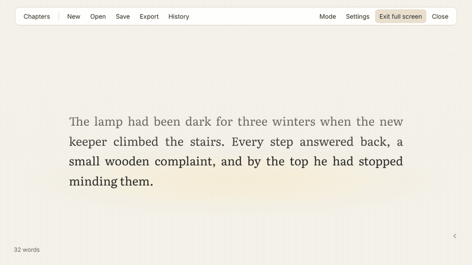
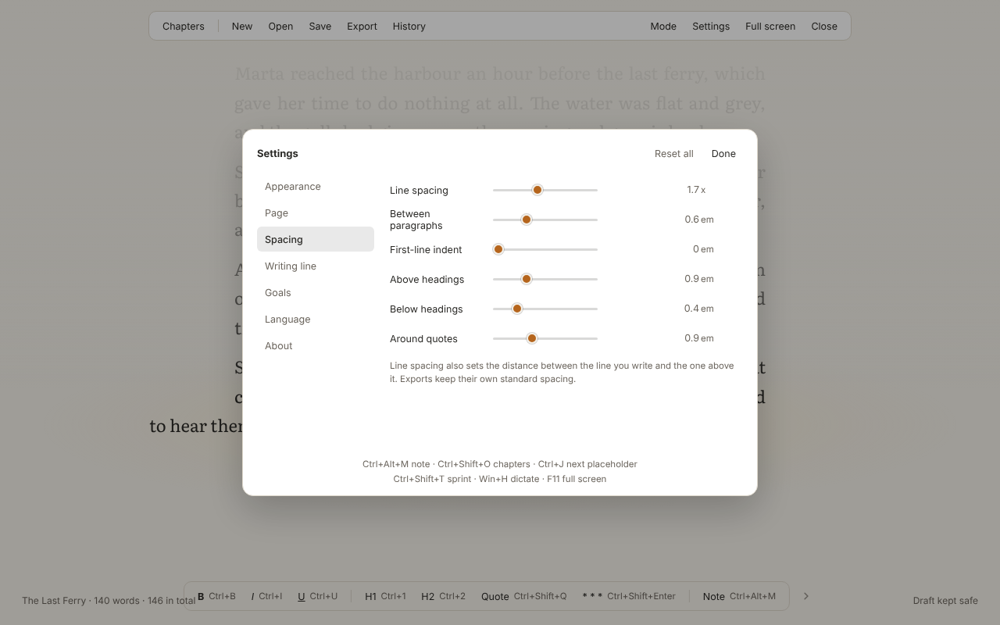

# Quire

A quiet place to write long things, like books.

The line you are writing stays in one place, low on the screen, like paper feeding through a typewriter. Everything else stays out of the way.

Quire works fully offline. There is no account, no tracking, and your writing never leaves your computer unless you put it somewhere yourself (see [Privacy](#privacy)).

## Download

Get the installer from the [**Releases**](../../releases/latest) page:

* **`Quire-Setup-x.y.z.exe`**: the normal installer. Works on every Windows PC, Intel/AMD or ARM (such as a Surface Pro X).
* **`Quire-x.y.z-x86_64.AppImage`** (Linux, new, 64-bit only): make it executable with `chmod +x` and run it.
* **`Quire-Portable-x.y.z-x64.exe`** (or `-arm64.exe`): runs without installing, from a USB stick for example. It does not update itself.

**Windows will warn you the first time.** Quire is not code-signed (a signing certificate costs money and is not worth it for a small free project), so Windows SmartScreen shows "Windows protected your PC". Click **More info**, then **Run anyway**. The warning is about the missing signature, not about anything found in the file.

The installed version checks for a new release when it starts and every few hours while it is open (nothing happens if you are offline), downloads it quietly and installs it the next time you close Quire. Settings, under **About**, shows which version you have, lets you check for updates right away and turns automatic checking off.

## What it does

* **A typewriter line.** The line you are typing stays near the middle of the screen while the text slides under it. Moving around or editing older text never moves anything.
* **Made for books.** Chapters, a table of contents for each chapter, a title page with subtitle, author and an extra line, and notes on any passage. A new book can start blank or from a simple structure: novel, short story, non-fiction book or scientific article.
* **Book, Single text or Journal.** When you start something new you choose what it is. A book has chapters and a title page. A single text (a story, an essay, an article) has no chapters to manage. A journal keeps dated entries: each one is stamped with the day and time, **Ctrl+Shift+E** starts the next, the book targets stay out of the way, and exports begin every entry with its date. A journal has its own Settings section: how dates and times are written, whether opening it on a new day starts a new entry, and when a new day begins for night owls. Click an entry's date in the Entries panel to change it, for example to write about yesterday.
* **Quiet by default.** Menus hide while you type. Focus mode dims everything except the paragraph or sentence you are writing.
* **Your page, your way.** Light, dark and an Evening theme that turns dark at sunset (worked out from your time zone, no internet needed),  three bundled fonts, text weight, size and width, and full control of the spacing between lines, paragraphs, headings and quotes.
* **Review mode** for proof-reading, with typos and notes standing out. Spellcheck works in several languages.
* **Reading mode** to read a chapter or the whole book as a reader would, with a **Listen** button that reads it aloud using a voice installed on your computer. Hearing it is a good way to catch what your eyes skip.
* **Keeps you moving.** Do not know a name or a fact? Type `TK` or `[[what you need]]`, keep writing, and jump back through them with Ctrl+J. Sprints give you a timed burst with no countdown until the last minute. Names that keep coming up in your book are offered as you type (Tab accepts).
* **Goals** (optional): a daily word goal, a book target, a streak of days in a row, the words written this session, a finish date that works out how many words a day you need, and a calendar of the last twelve weeks (kept on your computer only). Each chapter can also have its own word target: click the word count of a chapter in the Chapters panel.
* **Your work is safe.** Automatic saving, a recovery copy if the app closes unexpectedly, and a History of snapshots you can open at any time. You can name a version, for example "Before the rewrite".
* **Open and export.** Open `.draft`, Markdown, plain text and Word files. Export to Word, PDF, an e-book (`.epub`), Markdown or plain text, choosing the chapters, page size and margins, and whether to include the title page and page numbers.

## Getting started

1. Start Quire and begin typing. Your work is saved automatically.
2. Press **Ctrl+S** to give the file a name. Quire suggests one based on your title.
3. Move the mouse to the top of the window to show the menu. It hides again while you write.
4. Press **Ctrl+Shift+O** to open the Chapters panel, where you can add chapters, set the book title and author, and jump around.
5. When you are done, **Export** (Ctrl+E) makes a Word file or PDF.

You can also drag a file onto the window to open it.

## Shortcuts

| Action | Shortcut |
|---|---|
| Bold / italic / underline | Ctrl+B / Ctrl+I / Ctrl+U |
| Heading 1 to 4 / normal text | Ctrl+1 to Ctrl+4 / Ctrl+0 (press again to turn off; levels 3 and 4 need Settings, Formatting bar) |
| Quote | Ctrl+Shift+Q (press again to turn off) |
| Poem (lines kept as written, stanzas separated by an empty line) | Ctrl+Shift+P (press again to turn off) |
| Scene break (a centered * * * between two parts of a chapter) | Ctrl+Shift+Enter |
| Add or edit a note on selected text | Ctrl+Alt+M |
| Undo / redo (each chapter keeps its own) | Ctrl+Z / Ctrl+Y |
| Find / find and replace | Ctrl+F / Ctrl+H (F3 for the next match; **List** shows every match) |
| Paste as plain text | Ctrl+Shift+V |
| Next / previous placeholder (`TK` or `[[ ]]`) | Ctrl+J / Ctrl+Shift+J |
| Start or stop a sprint | Ctrl+Shift+T |
| Accept a name suggestion | Tab |
| Chapters panel | Ctrl+Shift+O |
| New entry (journals) | Ctrl+Shift+E |
| Notebook (books): search and edit your world notes | Ctrl+K |
| Next / previous chapter | Ctrl+PageDown / Ctrl+PageUp |
| New / open / save / save as | Ctrl+N / Ctrl+O / Ctrl+S / Ctrl+Shift+S |
| Export | Ctrl+E |
| Show or hide the formatting bar | Ctrl+/ |
| Settings | Ctrl+, |
| Full screen | F11 |
| Open the top bar with the keyboard | F10 |

Markdown shortcuts work while you type: `# ` at the start of a line makes a heading, `## ` a sub-heading and `> ` a quote. `**bold**` and `*italic*` convert when you type the closing mark.

## Writing in more detail

**Quotes** are set like an epigraph in a book: narrower, a little smaller and to the right. Enter keeps writing in the quote. Enter on an empty line, or after the author line, leaves it. A quote line that starts with a dash is the author.

**Poems** keep every line break. Enter ends a line, Enter on an empty line starts the next stanza, and Enter in an empty stanza goes back to prose. Poems are left aligned and set in from the margin, and the exports keep them that way. Spaces at the start of a line are kept, so you can indent a line. In the editor, PDF, HTML and EPUB a line too long to fit wraps with a hanging indent so it still reads as one line; the Word copy keeps each stanza as one paragraph so it can be brought back into Quire. Select several paragraphs and press Poem to turn them into one stanza (a blank paragraph starts the next stanza), and use Tab and Shift+Tab to indent a line and take the indent back.

**Formatting bar.** In Settings, Formatting bar, choose which buttons show and whether their shortcuts appear beside them. Quote, Poem and Scene break start hidden. The same section sets how many heading levels you use (2 by default, up to 4): Ctrl+1 to Ctrl+4, or #, ##, ### and #### at the start of a line. Hidden buttons still work through their shortcuts and Markdown.

**Notebook.** A book can keep notes about its world: places, people, religions, calendars, anything you keep inventing. Press **Ctrl+K** (or use Notebook in the Chapters panel) to open a panel on the right. Type to search by title, category or text, press Enter to open the first match, and keep writing while it stays open. A page has a title, a category you choose, and free text. Pages are saved inside the book file, are never exported, and are not counted in word totals. Ctrl+K or Esc closes the panel. Journals and single texts do not have a notebook. Use it for a poem inside any chapter, such as a prologue.

**Caret centering** (Settings, Writing line) has three choices: *Off*; *Centered* (the default, the caret stays in the middle and the text moves under it); *Soft* (the caret may wander a little, then the line glides back).

**Notes.** Select text and press Ctrl+Alt+M. A small icon appears in the margin: click it to open or close the note, or hover to read it. Notes can be included when you export, as comments in Word.

**Smart quotes** (Settings, off by default): curly quotes in English, Spanish and Catalan (« ») or German style, and three dots become one ellipsis character. Turn it on only if you want the app to change what you type.

**Word copy for your phone** (Settings, off by default). With this on, saving a book also writes a `.docx` next to the `.draft`. Keep the book in a Google Drive folder (Drive for desktop) and you can open the `.docx` in Google Docs on your phone and edit it there, still as a Word file. Next time you open the book in Quire, or come back to the window, Quire notices the changed Word copy and shows what changed, so you can **import** the changes or keep your version. Nothing is replaced without asking, a snapshot goes to History first, and your notes, chapter targets and page-number settings stay (they live in the `.draft`). Quire never overwrites a Word copy that was changed elsewhere without asking. Comments added in Word or Google Docs are not imported. Do not use "Save as Google Docs": that makes a separate Google Docs file that Quire cannot read; Quire will point that out if it sees one next to your book.

**Dictation.** Quire has no voice typing of its own, but Windows voice typing (Win+H) can dictate into it like any other text field.

**Friendly messages** (Settings, on by default): a short greeting when you open the app, depending on the time of day, and a cheer when you reach your daily goal or a chapter target (once a day each). One switch turns them off.

**Comparing versions.** In History, **Compare** shows what changed between an earlier version and the text now: struck red words were in the old version, green words are new. You can open that version as a new document from there.

**Pasting** keeps bold, italic, underline, headings and quotes and drops everything else. Use Ctrl+Shift+V for plain text.

## Your files

* Your work is saved as a **`.draft`** file. It is plain, readable text, so it also works well with Git, OneDrive or Dropbox.
* **Saving.** Ctrl+S saves in place. While you write, Quire also saves automatically: to your file once it has a name, otherwise to a recovery copy that comes back the next time you start the app.
* **History** keeps a snapshot every few minutes and also what was there before any save that removes a lot of text. Open an old snapshot from **History**; it opens as a new document.
* **If another program changes your file** (Git, OneDrive, Dropbox), Quire never overwrites it silently. It asks whether to keep yours, load theirs or save yours as a copy.
* **Word files.** Opening a `.docx` keeps headings, bold, italic, underline and quotes. With two or more Heading 1, each one starts a chapter. Images, tables and comments are not imported yet.

## Exporting

* **Word, PDF, e-book, Markdown or plain text.** Pick the **page size** (A4, US Letter, A5, trade paperback 6 x 9 in, digest) and the **margins** (narrow, normal, wide) in the Export menu. The e-book is an EPUB 3 file that opens in Kindle apps, Apple Books, Kobo and most readers.
* **Notes** can be left out, exported as comments (Word) or as real footnotes. With footnotes, Word gets proper footnotes, the PDF gets a list at the end of each chapter and the e-book gets linked endnotes.
* **Scene breaks** (`* * *`) are centered in every format. In Markdown a line of `---` or `***` becomes a scene break when you open the file.
* **Choose chapters** to export just part of a book.
* **Title page** with title, subtitle, author and an extra line such as "A novel". It is ticked by default when the book has a title; empty fields are left out. The title page is never numbered or counted, so chapter one is page 1.
* **Page numbers** can be switched off for the whole export, or for single chapters with the **#** button in the Chapters panel. The page is still counted, only the number is hidden.
* Chapters start on a new page, headings stay with the paragraph that follows, and quotes are not split across pages.
* Word files carry their own copy of the font, so they look the same on any PC.

## Settings

Press Ctrl+, to open Settings. A small **i** next to the more involved settings explains in a sentence what they do (hover or tab to it). Sections: Appearance, Page, Spacing, Writing line, Goals, Language and About (your version, updates and a **Copy diagnostics** button to paste into a bug report). Every slider has a number you can type and a small arrow to put it back to its default. **Reset all** restores everything.

## Privacy

Quire is built to work completely offline, and your writing stays on your computer.

- **No account, no analytics, no tracking.** Quire does not collect or send usage data of any kind.
- **Your files are yours.** Drafts are saved only where you choose. Recovery copies, version history and settings are kept in Quire's own folder on your computer. If you save into a folder that OneDrive, Google Drive, Dropbox or similar syncs, that service syncs the file, not Quire.
- **The only network request** is the check for a new version, which asks GitHub for the latest release information. GitHub can see the usual things any web request reveals, such as your IP address. You can turn the check off in Settings, under About, and nothing happens when you are offline.
- **Nothing is sent without you.** Copy diagnostics only puts text on your clipboard. Report a problem opens a page in your browser with your version filled in, and nothing is posted until you submit it yourself.

## Feedback

Found a bug or have an idea? Please open an [issue](../../issues). If you are a developer, see [DEVELOPING.md](DEVELOPING.md).

## License

Quire is free software under the MIT license (see `LICENSE`). The bundled fonts (Literata, Nunito, Courier Prime and Inter) are under the SIL Open Font License; their licenses are in `renderer/fonts/licenses/`.
