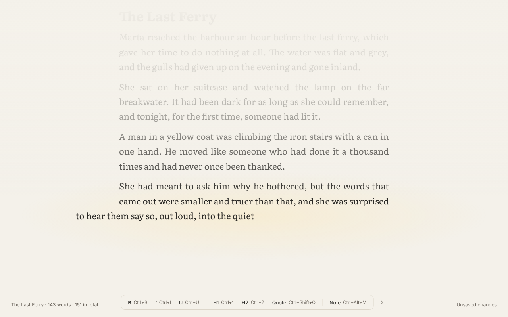
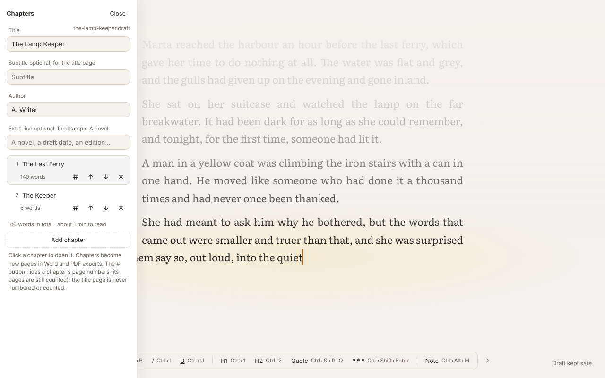
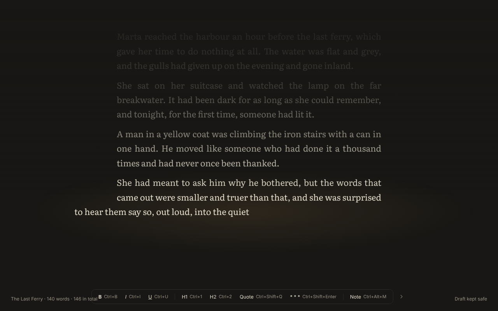

# Quire

A quiet place to write long things, like books.

The line you are writing stays in one place, low on the screen, like paper feeding through a typewriter. Everything else stays out of the way.

## Download

Get the installer from the [**Releases**](../../releases/latest) page:

* **`Quire-Setup-x.y.z.exe`**: the normal installer. Works on every Windows PC, Intel/AMD or ARM (such as a Surface Pro X).
* **`Quire-Portable-x.y.z-x64.exe`** (or `-arm64.exe`): runs without installing, from a USB stick for example. It does not update itself.

**Windows will warn you the first time.** Quire is not code-signed (a signing certificate costs money and is not worth it for a small free project), so Windows SmartScreen shows "Windows protected your PC". Click **More info**, then **Run anyway**. The warning is about the missing signature, not about anything found in the file.

The installed version checks for a new release when it starts, downloads it quietly and installs it the next time you close Quire. Settings, under **About**, shows which version you have, lets you check for updates right away and turns automatic checking off.

## What it does

* **A typewriter line.** The line you are typing stays near the middle of the screen while the text slides under it. Moving around or editing older text never moves anything.
* **Made for books.** Chapters, a table of contents for each chapter, a title page with subtitle, author and an extra line, and notes on any passage.
* **Quiet by default.** Menus hide while you type. Focus mode dims everything except the paragraph or sentence you are writing.
* **Your page, your way.** Light and dark themes, three bundled fonts, text weight, size and width, and full control of the spacing between lines, paragraphs, headings and quotes.
* **Review mode** for proof-reading, with typos and notes standing out. Spellcheck works in several languages.
* **Reading mode** to read a chapter or the whole book as a reader would.
* **Goals** (optional): a daily word goal, a book target, a streak of days in a row and the words written this session.
* **Your work is safe.** Automatic saving, a recovery copy if the app closes unexpectedly, and a History of snapshots you can open at any time. You can name a version, for example "Before the rewrite".
* **Open and export.** Open `.draft`, Markdown, plain text and Word files. Export to Word, PDF, Markdown or plain text, choosing which chapters go in and whether to include the title page and page numbers.

## Getting started

1. Start Quire and begin typing. Your work is saved automatically.
2. Press **Ctrl+S** to give the file a name. Quire suggests one based on your title.
3. Move the mouse to the top of the window to show the menu. It hides again while you write.
4. Press **Ctrl+Shift+O** to open the Chapters panel, where you can add chapters, set the book title and author, and jump around.
5. When you are done, **Export** (Ctrl+E) makes a Word file or PDF.

You can also drag a file onto the window to open it.

## Shortcuts

| Action | Shortcut |
|---|---|
| Bold / italic / underline | Ctrl+B / Ctrl+I / Ctrl+U |
| Heading 1 / heading 2 / normal text | Ctrl+1 / Ctrl+2 / Ctrl+0 (press again to turn off) |
| Quote | Ctrl+Shift+Q (press again to turn off) |
| Add or edit a note on selected text | Ctrl+Alt+M |
| Undo / redo (each chapter keeps its own) | Ctrl+Z / Ctrl+Y |
| Find / find and replace | Ctrl+F / Ctrl+H (F3 for the next match; **List** shows every match) |
| Paste as plain text | Ctrl+Shift+V |
| Chapters panel | Ctrl+Shift+O |
| Next / previous chapter | Ctrl+PageDown / Ctrl+PageUp |
| New / open / save / save as | Ctrl+N / Ctrl+O / Ctrl+S / Ctrl+Shift+S |
| Export | Ctrl+E |
| Show or hide the formatting bar | Ctrl+/ |
| Settings | Ctrl+, |
| Full screen | F11 |
| Open the top bar with the keyboard | F10 |

Markdown shortcuts work while you type: `# ` at the start of a line makes a heading, `## ` a sub-heading and `> ` a quote. `**bold**` and `*italic*` convert when you type the closing mark.

## Writing in more detail

**Quotes** are set like an epigraph in a book: narrower, a little smaller and to the right. Enter keeps writing in the quote. Enter on an empty line, or after the author line, leaves it. A quote line that starts with a dash is the author.

**Caret centering** (Settings, Writing line) has three choices: *Off*; *Centered* (the default, the caret stays in the middle and the text moves under it); *Soft* (the caret may wander a little, then the line glides back).

**Notes.** Select text and press Ctrl+Alt+M. A small icon appears in the margin: click it to open or close the note, or hover to read it. Notes can be included when you export, as comments in Word.

**Pasting** keeps bold, italic, underline, headings and quotes and drops everything else. Use Ctrl+Shift+V for plain text.

## Your files

* Your work is saved as a **`.draft`** file. It is plain, readable text, so it also works well with Git, OneDrive or Dropbox.
* **Saving.** Ctrl+S saves in place. While you write, Quire also saves automatically: to your file once it has a name, otherwise to a recovery copy that comes back the next time you start the app.
* **History** keeps a snapshot every few minutes and also what was there before any save that removes a lot of text. Open an old snapshot from **History**; it opens as a new document.
* **If another program changes your file** (Git, OneDrive, Dropbox), Quire never overwrites it silently. It asks whether to keep yours, load theirs or save yours as a copy.
* **Word files.** Opening a `.docx` keeps headings, bold, italic, underline and quotes. With two or more Heading 1, each one starts a chapter. Images, tables and comments are not imported yet.

## Exporting

* **Word, PDF, Markdown or plain text.** Word and PDF are A4 with 2.5 cm margins.
* **Choose chapters** to export just part of a book.
* **Title page** with title, subtitle, author and an extra line such as "A novel". It is ticked by default when the book has a title; empty fields are left out. The title page is never numbered or counted, so chapter one is page 1.
* **Page numbers** can be switched off for the whole export, or for single chapters with the **#** button in the Chapters panel. The page is still counted, only the number is hidden.
* Chapters start on a new page, headings stay with the paragraph that follows, and quotes are not split across pages.
* Word files carry their own copy of the font, so they look the same on any PC.

## Settings

Press Ctrl+, to open Settings. Sections: Appearance, Page, Spacing, Writing line, Goals, Language and About (your version and updates). Every slider has a number you can type and a small arrow to put it back to its default. **Reset all** restores everything.

## Privacy

Quire works offline and keeps everything on your computer. The only network request it makes is the check for a new version, which you can turn off in Settings.

## Feedback

Found a bug or have an idea? Please open an [issue](../../issues). If you are a developer, see [DEVELOPING.md](DEVELOPING.md).

## License

Quire is free software under the MIT license (see `LICENSE`). The bundled fonts (Literata, Nunito, Courier Prime and Inter) are under the SIL Open Font License; their licenses are in `renderer/fonts/licenses/`.
